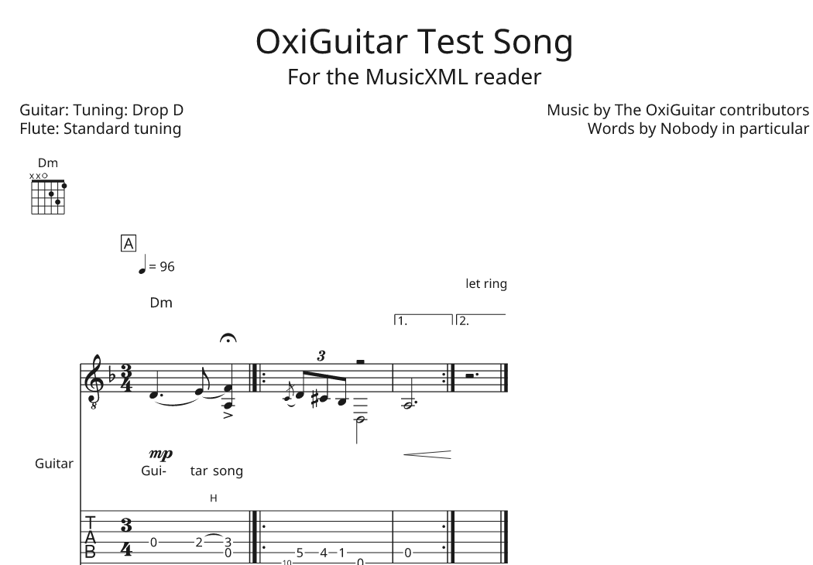

# oxiguitar-musicxml

The MusicXML plugin for [OxiGuitar](https://github.com/mateusrdp/oxiguitar), a free, open-source guitar tablature and score viewer, editor and player for Windows, macOS and Linux. MusicXML is the format notation programs exchange scores in: with this plugin OxiGuitar opens what MuseScore, Finale, Sibelius, Dorico or Guitar Pro export, and saves scores they can open.

| Plugin file | Id | Reads | Writes |
| --- | --- | --- | --- |
| `musicxml.oxp` | `oxiguitar.musicxml` | MusicXML (.musicxml, .xml) and compressed MusicXML (.mxl) | both |

A part the file marks as a guitar or a bass opens as tablature; when the file has a tablature staff, its strings, frets and tuning are kept, and when it has only notes, OxiGuitar finds a fingering for them as the file opens. Every other pitched part (a melody, a piano) is fingered too, but shows notation only until you turn its tablature on in the Track tab. Drums open as drums. When OxiGuitar saves MusicXML, each guitar is written as a notation staff and a tablature staff, so the fingering survives in any program that reads tablature, and OxiGuitar tells you first about anything MusicXML can't hold (a whammy bar, say).



The picture is OxiGuitar engraving [`fixtures/oxiguitar-test.musicxml`](fixtures/oxiguitar-test.musicxml), a file we wrote ourselves: a guitar in Drop D whose frets come from the file's tablature, a chord symbol with its diagram, lyrics, a triplet after a grace note, a second voice, repeats with two endings. The plugin has no sound of its own: it only reads and writes files. What you hear comes from [oxiguitar-midi](https://github.com/mateusrdp/oxiguitar-midi) and an audio output plugin.

The file type is decided from the file's contents, never from its extension: OxiGuitar recognises MusicXML by its first element, `score-partwise` or `score-timewise`, and compressed MusicXML by its root file's. That needs OxiGuitar 0.18 or later (plugin interface 1.7).

[docs/design.md](docs/design.md) says what is read and written and what is left out, and why.

## Install

Every [release](https://github.com/mateusrdp/oxiguitar-musicxml/releases) holds a zip per system (Linux x86_64 and ARM64, Windows x86_64 and ARM64, macOS), a `.deb` and an `.rpm` for Linux, a per-user installer for Windows (no administrator needed), a `.pkg` for macOS, and a `SHA256SUMS` file. The OxiGuitar manual's [install page](https://mateusrdp.github.io/oxiguitar/installing.html) says which one to use and how to keep plugins updated through your package manager.

You can also copy `musicxml.oxp` from a zip into OxiGuitar's plugin folder by hand ([Settings and plugins](https://mateusrdp.github.io/oxiguitar/plugins.html)).

Found a file it reads wrongly? Please [open an issue](https://github.com/mateusrdp/oxiguitar-musicxml/issues/new) with the file if you can share it, and the program that wrote it.

## Build and test

Rust 1.99 or later from [rustup](https://rustup.rs). The plugin SDK and the score model come from OxiGuitar's repository by git (plugin interface 1.7); nothing of OxiGuitar's is on crates.io. MusicXML itself is read and written with the [musicxml](https://crates.io/crates/musicxml) crate.

```sh
cargo test                  # the reader, the writer, and the plugin as an .oxp file
./build-oxp.sh              # dist/musicxml-VERSION-SYSTEM-ARCH.oxp
```

`cargo test` reads and writes our own file, damaged files and the edge cases in `tests/`, then builds the plugin as the `.oxp` file we ship and checks it through OxiGuitar's own plugin host (the contract suite of `oxiguitar-plugin-test`). With MusicXML files of a private collection unpacked into `corpus/files/` (never committed), `cargo test --test corpus` round-trips each of them. [CONTRIBUTING.md](CONTRIBUTING.md) has the rest of the rules.

What is where:

- `src/read.rs`, `src/write.rs`: MusicXML into OxiGuitar's score and back.
- `src/mxl.rs`: compressed MusicXML archives. `src/text.rs`: text encodings and XML escaping around the musicxml crate.
- `src/instruments.rs`: which parts are guitars, basses, drums or anything else.
- `fixtures/`: our own MusicXML file.
- `fuzz/`: fuzz targets for the reader and the writer ([fuzz/README.md](fuzz/README.md)).

## Releases

The maintainer releases with the Release button in [oxiguitar-packages](https://github.com/mateusrdp/oxiguitar-packages): it bumps the version, merges `develop` into `main` and tags it. [`release.yml`](.github/workflows/release.yml) then builds the plugin for every system with the packages' reusable plugin-release workflow, makes the packages and a draft release; publishing the draft starts [`publish.yml`](.github/workflows/publish.yml), which tells the package repositories. Every pull request gets the same builds as test builds, kept for 14 days under its Release run.

## Licence

GPL-3.0-or-later. See LICENSE.
Contributions are welcome under the same terms; see
[CONTRIBUTING.md](CONTRIBUTING.md).
