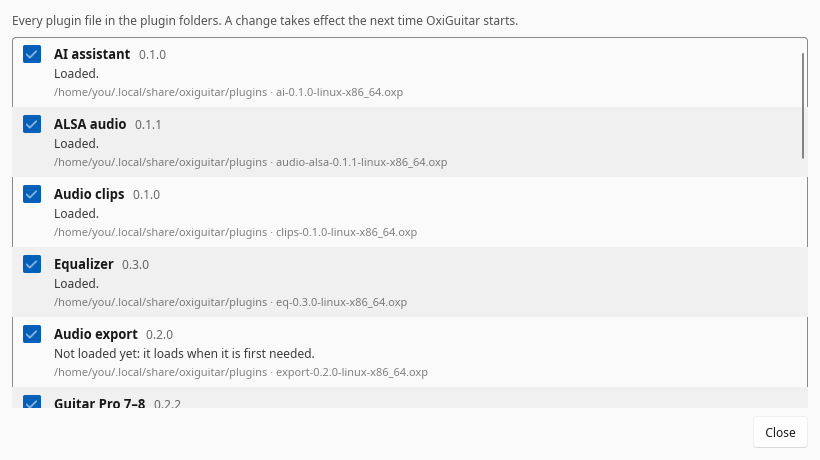

# How to use it

## Check it is installed

**Tools → Plugins…** lists every plugin OxiGuitar found, with its version, and lets you switch any of them off:

## Open and save

- **Open**: **File → Open…** and pick a `.musicxml`, `.xml` or `.mxl` file, or double-click one if your system links the file type to OxiGuitar. OxiGuitar looks inside the file to decide which plugin reads it; the extension doesn't matter.
- **Save**: **File → Save As…** and pick MusicXML as the format. If the format can't hold everything in your score, OxiGuitar says what would be lost before it saves, and you can keep the rest in the `.oxg` file beside it.
- **The import log**: anything the MusicXML plugin couldn't bring across is listed in the footer at the bottom of the window when the file opens.

## What you can do with it

- Bring a score from another notation program into OxiGuitar. Guitar and bass parts open as tablature. When the file has only notes, OxiGuitar works out a fingering as it opens.
- Send a score back out. Each guitar is written as a notation staff and a tablature staff, so the frets survive in programs that read tablature.
- Open the drums of a score as drums.
- Move a score through MusicXML as a neutral stop between OxiGuitar and a program with no direct support.

Other pitched parts, such as a melody or a piano, are fingered too but show notation only until you turn their tablature on in the Track tab. When MusicXML can't hold something, such as a whammy bar, OxiGuitar tells you before it saves.
